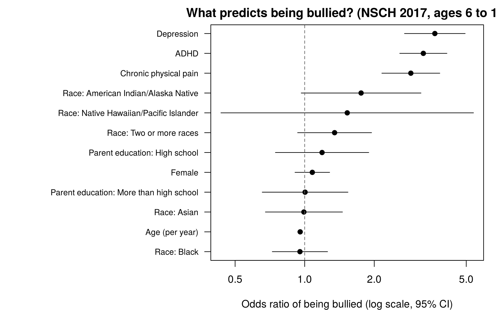

# What Predicts Bullying Among U.S. Children?

Logistic regression on the **2017 National Survey of Children's Health (NSCH)** to find which health and family factors are linked to a child being bullied, picked on, or excluded by other children.

**Author:** Erica Mathias (team project, 4 members)

## Key findings

Among **15,040 children aged 6 to 17**, about **1 in 5 (20.6%, survey-weighted)** had been bullied. Holding the other factors constant:

| Factor | Odds ratio (95% CI) | Meaning |
|---|---|---|
| **Depression** | **3.66** (2.70 to 4.95) | Children with depression had about 3.7 times the odds of being bullied |
| **ADHD** | **3.26** (2.58 to 4.13) | About 3.3 times the odds |
| **Chronic physical pain** | **2.88** (2.16 to 3.84) | About 2.9 times the odds |
| Age | 0.96 per year (0.93 to 0.98) | Odds fall about 4% with each year of age |
| Sex, race, parent education | Not significant | No meaningful difference after adjusting for health factors |

The takeaway: **a child's health conditions were far stronger predictors of bullying than demographics.** That points to schools and pediatric care as places to screen for bullying among children with depression, ADHD or chronic pain.



## Method

1. **Data:** NSCH 2017 topical file from the U.S. Census Bureau (about 21,600 children). The bullying question is asked for ages 6 to 17.
2. **Outcome:** bullied (definitely or somewhat true) vs. not bullied.
3. **Predictors:** age, sex, race, ADHD, depression, chronic physical pain, and the highest education level of adults in the household.
4. **Checks:** multicollinearity with VIF (all close to 1.0), complete-case analysis.
5. **Models:** standard logistic regression, plus a **survey-weighted** logistic regression using NSCH weights, strata and household clusters so results represent all U.S. children.
6. **Fit:** AUC 0.67, McFadden pseudo R² 0.08. The model identifies risk factors well but is not meant as a precise individual-level predictor.

## Files

| File | Purpose |
|---|---|
| `bullying_model.R` | Full analysis: cleaning, recoding, VIF, both models, odds ratios, chart |
| `results/model_output.txt` | Complete R output |
| `results/odds_ratios_weighted.csv` | Survey-weighted odds ratios with 95% CIs |
| `results/odds_ratios.png` | Forest plot of odds ratios |

## Run it

1. Download the free Stata file: [nsch_2017_topical_Stata.zip](https://www2.census.gov/programs-surveys/nsch/datasets/2017/nsch_2017_topical_Stata.zip) and unzip it into a `data/` folder.
2. In R:

```r
install.packages(c("haven", "dplyr", "car", "survey"))
source("bullying_model.R")
```

## Tools

R (haven, dplyr, car, survey), logistic regression, complex survey weighting
